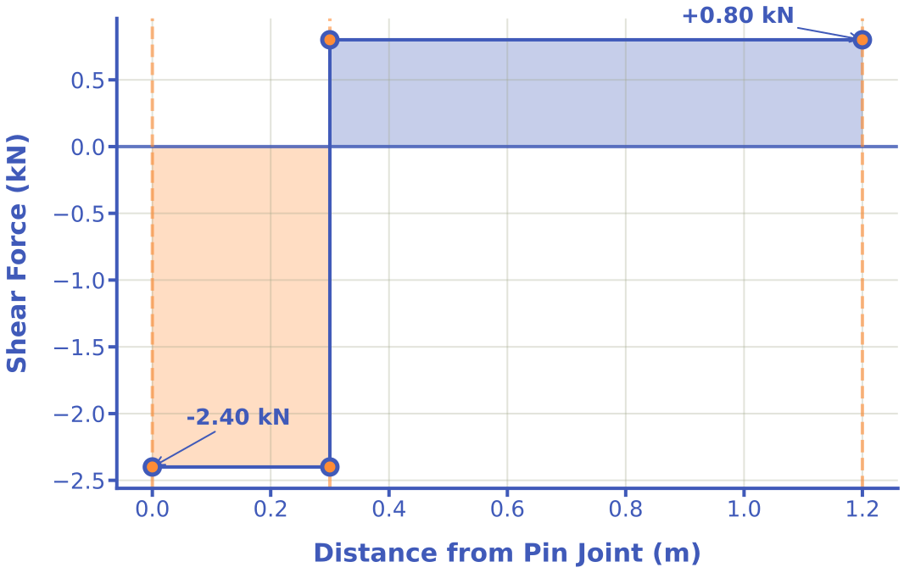
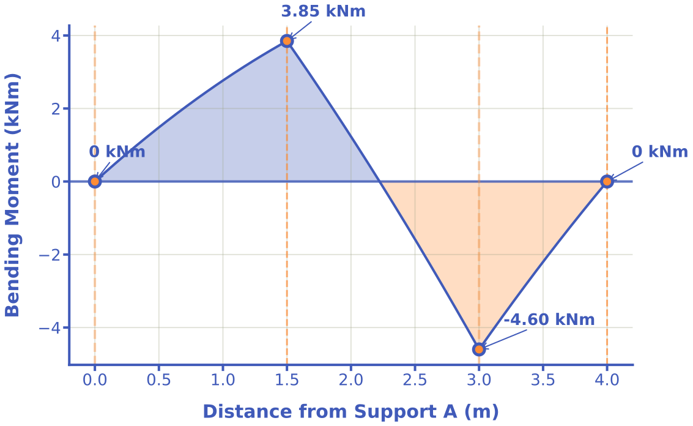

import MechanicsOfMaterialsComments from '../../../../components/mechanics-of-materials/MechanicsOfMaterialsComments.astro';
import TawkWidget from '../../../../components/TawkWidget.astro';
import UniversalContentContributors from '../../../../components/UniversalContentContributors.astro';
import InArticleAd from '../../../../components/InArticleAd.astro';
import Copyright from '../../../../components/Copyright.astro';
import BionicText from '../../../../components/BionicText.astro';
import TailwindWrapper from '../../../../components/TailwindWrapper.jsx';
import { Tabs, TabItem } from '@astrojs/starlight/components';
import { Card, CardGrid, Badge, Steps, LinkButton, FileTree } from '@astrojs/starlight/components';

<UniversalContentContributors 
  contributors={frontmatter.contributors}
/>


import ChartEmbed from '../../../../components/mechanics-of-materials/ChartEmbed.astro';
import LoadingDiagramEmbed from '../../../../components/mechanics-of-materials/LoadingDiagramEmbed.astro';

Lay a wooden ruler flat across two books and press on its middle: it bends easily. Turn it on its edge and press again: it hardly moves. It is the same wood, and the same amount of it. A beam that is sized by the amount of material alone can yield or crack at the one face where the stress peaks, while most of its material does almost no work. This lesson gives you the flexural formula, which finds the largest stress in a bent beam from the bending moment and the shape of the cross-section. You then use it on a pantograph arm, a crane jib and a 3D printer rail. #FlexuralFormula #BeamAnalysis #StructuralDesign

## Learning Objectives

By the end of this lesson, you will be able to:
1. Calculate bending stresses in beams using the flexural formula for various loading conditions
2. Locate the neutral axis and identify where the stress is largest in a beam cross-section
3. Analyze the stress distribution and the shear and moment diagrams for different beam types
4. Design structural members for both tensile and compressive stress limits in real-world applications

:::tip[Try it as you read]
This lesson pairs with the [Beam Analysis Simulator](/product-development/beam-analysis-simulator/): choose a cross-section and watch the maximum bending stress respond as you change the load and the section dimensions. The [Beam Analysis Experiments](/education/mechanics-of-materials/beam-analysis-experiments/) reproduce the worked examples step by step with Python.
:::

## Engineering beams: the foundation of structural design

<InArticleAd />


<div style={{ display: 'flex', justifyContent: 'center', width: '100%' }}>
  <TailwindWrapper>
	
  </TailwindWrapper>
</div>

### The universal bending challenge

The lesson on [shear force and bending moment](/education/mechanics-of-materials/shear-force-bending-moment-beams/) ends with the largest bending moment in a beam. That number alone does not say if the beam is safe: a thick beam carries it easily, and a thin one breaks.

> **Engineering Question:** How large is the stress that a bending moment causes in a beam of a given cross-section, and is it below what the material can stand?

## Fundamental Theory: Bending stress mechanics

<InArticleAd />


### The flexural formula

Draw straight lines across the side of a rubber eraser and bend it. On the outside of the bend the lines move apart: the material there is stretched. On the inside they move together: the material there is squeezed. Between the two there is one layer whose length does not change. It is called the **neutral axis**.

The stretch grows in proportion to the distance from the neutral axis, and by Hooke's law the stress does the same. An eraser bends much farther than a metal beam: the formula below holds only for small bending, with the material below its yield strength.

```text
  cross-section      stress over the depth (sagging beam)

  ┌─────────┐ top     ◄──────────┤  largest compression
  │         │            ◄───────┤
  │         │                ◄───┤
  │┄┄┄┄┄┄┄┄┄│ ┄┄┄┄┄┄┄┄┄┄┄┄┄┄┄┄┄┄┄┤  zero at the neutral axis
  │         │                    ├───►
  │         │                    ├───────►
  └─────────┘ bottom             ├──────────►  largest tension
```

In words: the bending stress at a point is the bending moment, multiplied by the distance of the point from the neutral axis, divided by a number that describes the shape of the cross-section.

<Card title="Flexural formula: bending stress" icon="document">
$$\sigma = \frac{My}{I}$$

Where:
- $\sigma$ (sigma) = bending stress at the point (MPa, which is N/mm²)
- $M$ = bending moment at that section of the beam (N·mm; 1 N·m = 1,000 N·mm)
- $y$ = distance of the point from the neutral axis (mm)
- $I$ = second moment of area of the cross-section about the neutral axis (mm⁴)

The stress is zero at the neutral axis and largest at the top and bottom faces. Work in N and mm, and the answer is in MPa.
</Card>

### Neutral axis and stress distribution

<Tabs>
  <TabItem label="Neutral Axis Location">
    
    The neutral axis passes through the **centroid** of the cross-section, its centre of area. For a section that is the same above and below its middle (a rectangle, a round tube, an I-beam), the neutral axis is at mid-depth.
    
    The stress grows in a straight line from zero at the neutral axis to its largest value at the face farthest from it. This lesson calls that face the extreme fiber.
    
  </TabItem>
  <TabItem label="Maximum Stress">
    
    The largest stress is the flexural formula with $y$ at its largest value, $c$:

    <Card title="Maximum bending stress" icon="document">
    $$\sigma_{max} = \frac{M \cdot c}{I} = \frac{M}{S}$$
    
    Where:
    - $c$ = distance from the neutral axis to the extreme fiber (mm). For a symmetric section it is half the depth.
    - $S = \frac{I}{c}$ = section modulus (mm³)
    
    The section modulus is one number for the bending strength of a shape. Double $S$ and the stress halves.
    </Card>

    
  </TabItem>
  <TabItem label="Sign Convention">
    
    This lesson keeps the convention of the lesson on shear force and bending moment.
    
    - A **positive** bending moment makes the beam sag: **compression** on the top fiber, **tension** on the bottom fiber.
    - A **negative** bending moment makes the beam hog: **tension** on the top fiber, **compression** on the bottom fiber.
    - Tensile stress is written with a plus sign and compressive stress with a minus sign.
    
  </TabItem>
</Tabs>

### Second moment of area for common shapes

The second moment of area $I$ measures how far the material of a cross-section lies from the neutral axis. Each small piece of area counts by the square of its distance, so material far from the neutral axis counts much more than material near it. The unit is mm⁴.

**Rectangular section** (width $b$, depth $h$ in the direction of the load):
$$I = \frac{bh^3}{12} \qquad S = \frac{I}{h/2} = \frac{bh^2}{6}$$

**Solid circular section** (diameter $d$):
$$I = \frac{\pi d^4}{64}$$

**Round tube** (outer diameter $D$, inner diameter $d$):
$$I = \frac{\pi (D^4 - d^4)}{64}$$

**Why depth matters far more than width.** In $S = bh^2/6$ the width counts once and the depth counts twice. Take a steel bar of $60\ \text{mm} \times 20\ \text{mm}$ under a bending moment of 720 N·m, which is 720,000 N·mm:

- Lying flat ($b = 60$, $h = 20$): $S = 60 \times 20^2/6$ = 4,000 mm³, so the largest stress is 720,000 ÷ 4,000 = 180 MPa.
- On edge ($b = 20$, $h = 60$): $S = 20 \times 60^2/6$ = 12,000 mm³, so the largest stress is 720,000 ÷ 12,000 = 60 MPa.

The same bar carries the same moment at one third of the stress. This is the ruler on its edge, and it is why an I-beam puts most of its metal in two flanges, far from the neutral axis. The rule has a limit: a section that is very deep and very thin twists and falls sideways before it reaches this stress.

## Application 1: Pantograph arm of electric train (electromechanical)

<InArticleAd />


A pantograph is the folding arm on the roof of an electric train that presses a contact strip up against the overhead wire. The arm turns about a pin joint at its base, and a spring pushes it up so that it follows the wire as the wire height changes.

:::note[System Problem Statement]
- **Support:** a pin joint at A. It lets the arm rotate and gives a vertical reaction only.
- **Loading:** the wire pushes down on the tip with $P_1$, and the spring pushes up with $F_{\text{spring}}$ part of the way along (the model picture labels the spring force P2)
<div style={{ display: 'flex', justifyContent: 'center', width: '100%' }}>
  <TailwindWrapper>
    
  </TailwindWrapper>
</div>

- **Find:** the spring force, the pin reaction, the shear force and bending moment diagrams, the largest bending stress, and the safety factor against yield

**Key Question:** Where does maximum bending stress occur in this pin-supported beam with spring loading, and does the design provide adequate safety margin for dynamic railway operations?
:::

Set this beam and section in the simulator and read the maximum bending stress directly:

<div style={{ display: 'flex', justifyContent: 'center', width: '100%', margin: '0.5rem 0 1rem' }}>
  <LinkButton href="/product-development/beam-analysis-simulator/" target="_blank" variant="primary">Open the Beam Analysis Simulator</LinkButton>
</div>

<Card title="Equivalent system model" icon="document">
<div style={{ display: 'flex', justifyContent: 'center', width: '100%' }}>
  <TailwindWrapper>
	
  </TailwindWrapper>
</div>

**Geometry:**
- Hollow steel tube: outer diameter $D = 50\ \text{mm}$, wall thickness 4 mm
- Arm length: $L = 1200\ \text{mm}$ from pin joint A to the contact point
- Spring: 300 mm from pin joint A

**Loads:**
- Wire contact force: $P_1 = 800\ \text{N}$ downward at the tip (the push of the overhead wire)
- Spring force: $F_{\text{spring}}$, upward, to be found from equilibrium

**Cross-section:**
- Inner diameter: $d = 50 - 2 \times 4 = 42\ \text{mm}$
- Second moment of area: $I = \pi(D^4 - d^4)/64 = \pi(50^4 - 42^4)/64 = 1.5405 \times 10^5\ \text{mm}^4$
- Distance to extreme fiber: $c = D/2 = 25\ \text{mm}$
- Section modulus: $S = I/c = 6{,}162\ \text{mm}^3$

**Material and safety:**
- Material: structural steel ($\sigma_{\text{yield}} = 250\ \text{MPa}$)
- Safety factor required: 3.0
</Card>

### Step 1: Calculate spring force and support reactions

<details>
<summary>**Click to reveal equilibrium calculations**</summary>

<Steps>

1. **List the forces on the arm,** with $x$ measured from the pin:

   - Pin joint at A ($x = 0$): a vertical reaction $R_A$. A pin cannot resist a moment.
   - Spring at $x = 300\ \text{mm}$: an upward force $F_{\text{spring}}$.
   - Wire contact at $x = 1200\ \text{mm}$: a downward force of 800 N.

2. **Find the spring force with moments about pin A.** The pin cannot resist a moment, so the moments of the other two forces about A must cancel. With counterclockwise positive:

   $F_{spring} \times 300 - P_1 \times 1200 = 0$

   $F_{spring} = \frac{800 \times 1200}{300} = \frac{960{,}000}{300} = 3200 \text{ N}$ ✅

   The spring is four times closer to the pin than the wire is (300 mm against 1200 mm), so it must push four times as hard.

3. **Find the pin reaction with the vertical forces:**

   $\sum F_y = 0$

   $R_A + F_{spring} - P_1 = 0$

   $R_A = P_1 - F_{spring} = 800 - 3200 = -2400 \text{ N}$

   **The negative sign means that $R_A$ acts downward:** the pin pulls down on the arm ✅

4. **Check the balance:**

   - **Vertical forces:** $-2400 + 3200 - 800 = 0$ ✅
   - **Moments about A:** $3200(0.3) - 800(1.2) = 960 - 960 = 0$ ✅

</Steps>

</details>

### Step 2: Shear force analysis

<details>
<summary>**Click to reveal shear calculations at critical points**</summary>

<Steps>
1. **Region 1: pin joint to spring ($0 \le x < 0.3\ \text{m}$):**

   Only $R_A$ acts to the left of a cut in this region:

   $V = R_A = -2400 \text{ N}$

   - Negative: the left part is pulled down
   - No load acts in this region, so $V$ stays constant ✅

2. **Region 2: spring to wire contact ($0.3\ \text{m} < x \le 1.2\ \text{m}$):**

   Past the spring, the upward spring force is added:

   $V = R_A + F_{spring} = -2400 + 3200 = +800 \text{ N}$

   - Positive: the left part is pushed up
   - $V$ stays constant up to the wire contact
   - At the wire contact ($x = 1.2\ \text{m}$) the 800 N downward force brings $V$ back to zero ✅

3. **Jump in the shear at the spring ($x = 0.3\ \text{m}$):**

   - Just before the spring: $V = -2400 \text{ N}$
   - Just after the spring: $V = +800 \text{ N}$
   - **Size of the jump:** $\Delta V = 800 - (-2400) = 3200 \text{ N}$, which is the spring force ✅

4. **Check the shear at the wire contact:**

   At $x = 1.2\ \text{m}$ (after the wire contact): $V = 800 - 800 = 0 \text{ N}$ ✅

</Steps>

<div style={{ display: 'flex', justifyContent: 'center', width: '100%' }}>
  <TailwindWrapper>
	
  </TailwindWrapper>
</div>

</details>

### Step 3: Bending moment analysis

<details>
<summary>**Click to reveal moment calculations at critical points**</summary>

Cut the arm at a position $x$ and add the moments, about the cut, of the forces to the left of the cut. Here $x$ is in metres and $M$ is in N·m.

<Steps>
1. **At the pin joint ($x = 0$):**

   No force lies to the left of this cut.

   $M = 0 \text{ N·m}$

   A pin joint cannot resist a moment ✅

2. **Region 1 ($0 < x < 0.3\ \text{m}$): pin to spring**

   Force to the left: $R_A$ only, at a distance $x$ from the cut.

   $M(x) = R_A \times x = -2400x$

   - The moment becomes more negative in a straight line.
   - At $x = 0.3\ \text{m}$ (the spring): $M = -2400(0.3) = -720 \text{ N·m}$ ✅

3. **Region 2 ($0.3\ \text{m} < x < 1.2\ \text{m}$): spring to wire**

   Forces to the left: $R_A$ at a distance $x$, and $F_{\text{spring}}$ at a distance $(x - 0.3)$.

   $M(x) = R_A \times x + F_{spring} \times (x - 0.3)$

   $M(x) = -2400x + 3200(x - 0.3) = -2400x + 3200x - 960 = 800x - 960$

   - At $x = 0.3\ \text{m}$: $M = 800(0.3) - 960 = -720 \text{ N·m}$ (the same value as from Region 1)
   - At $x = 0.6\ \text{m}$: $M = 800(0.6) - 960 = -480 \text{ N·m}$
   - At $x = 1.2\ \text{m}$ (wire contact): $M = 800(1.2) - 960 = 0 \text{ N·m}$ ✅

4. **Check at the free end.** Nothing applies a moment at the tip ($x = 1.2\ \text{m}$), so the moment there must be zero:

   $M = R_A(1.2) + F_{spring}(1.2 - 0.3) - P_1(0) = -2400(1.2) + 3200(0.9) = -2880 + 2880 = 0$ ✅

</Steps>

<div style={{ display: 'flex', justifyContent: 'center', width: '100%' }}>
  <TailwindWrapper>
	
  </TailwindWrapper>
</div>

The moment is negative along the whole arm, so the arm hogs: **tension on the top fiber** and **compression on the bottom fiber**. Its largest size is $|M_{max}| = 720\ \text{N}\cdot\text{m}$ at the spring ($x = 0.3\ \text{m}$), so the stress is checked there.

</details>

### Step 4: Calculate maximum bending stress

<details>
<summary>**Click to reveal stress calculations**</summary>

<Steps>

1. **Apply the flexural formula at the spring.** Work in N and mm: $M = 720\ \text{N}\cdot\text{m} = 720{,}000\ \text{N}\cdot\text{mm}$, $c = 25\ \text{mm}$, $I = 1.5405 \times 10^5\ \text{mm}^4$:

   $$\sigma_{max} = \frac{M \cdot c}{I} = \frac{720{,}000 \times 25}{1.5405 \times 10^5} = \frac{18{,}000{,}000}{154{,}050} = 116.8 \text{ MPa}$$

2. **Check with the section modulus:**

   $$S = \frac{I}{c} = \frac{1.5405 \times 10^5}{25} = 6{,}162 \text{ mm}^3$$

   $$\sigma_{max} = \frac{M}{S} = \frac{720{,}000}{6{,}162} = 116.8 \text{ MPa}$$ ✅

3. **Stress across the section at the spring ($x = 0.3\ \text{m}$):**

   - Largest tensile stress: +116.8 MPa (top fiber)
   - Largest compressive stress: -116.8 MPa (bottom fiber)
   - Stress at the neutral axis: 0 MPa ✅

</Steps>

</details>

### Step 5: Safety factor assessment

<details>
<summary>**Click to reveal safety calculations**</summary>

<Steps>

1. **Calculate the actual safety factor,** the yield strength divided by the largest stress:

   $$SF_{actual} = \frac{\sigma_{yield}}{\sigma_{max}} = \frac{250\ \text{MPa}}{116.8\ \text{MPa}} = 2.14$$

2. **Compare it with the required safety factor:**

   Required $\text{SF} = 3.0$
   Actual $\text{SF} = 2.14 < 3.0$

   The arm does **not** yield under the static load, but it does **not meet** the required safety factor of 3.0.

3. **Find the section modulus that is needed.** Turn $\text{SF} = \sigma_{yield}/\sigma_{max}$ and $\sigma_{max} = M/S$ around:

   $$S_{required} = \frac{SF \times M}{\sigma_{yield}} = \frac{3.0 \times 720{,}000}{250} = 8{,}640 \text{ mm}^3$$

   The $50\ \text{mm} \times 4\ \text{mm}$ tube has only $S = 6{,}162\ \text{mm}^3$.

4. **Choose a tube that passes.** A $60\ \text{mm} \times 4\ \text{mm}$ tube has $I = \pi(60^4 - 52^4)/64 = 2.773 \times 10^5\ \text{mm}^4$ and $S = I/30 = 9{,}242\ \text{mm}^3$. It gives $\sigma_{max} = 720{,}000/9{,}242 = 77.9\ \text{MPa}$ and $\text{SF} = 250/77.9 = 3.21$, which passes. ✅

   The factor of 3.0 covers what the static calculation leaves out: impact when the wire is lost and found again, millions of load cycles in service, and the danger of a broken arm next to a live wire.

</Steps>

</details>

### Step 6: Dynamic loading and failure risk analysis

<details>
<summary>**Click to reveal dynamic analysis**</summary>

<Steps>

1. **The load is not steady.** The calculation above uses a static contact force of 800 N. In service the contact force changes with the wire tension and the motion of the vehicle, from about 200 N to 1200 N. ✅

2. **Risk 1: the arm suddenly loses the wire.** The spring then throws the arm upward, and the arm can damage the wire or the contact strip. So a pantograph needs a damper ✅

3. **Risk 2: the arm hits the wire again.** The impact can multiply the static stress by a factor of 2 to 4.

   - With a factor of 2: $2 \times 116.8 = 233.6\ \text{MPa}$, just below yield ($\text{SF} = 250/233.6 = 1.07$)
   - With a factor of 4: $4 \times 116.8 = 467\ \text{MPa} > 250\ \text{MPa}$, so the $50\ \text{mm} \times 4\ \text{mm}$ tube would yield
   - To stay below yield at a factor of 4 the section needs $S \ge 4 \times 720{,}000/250 = 11{,}520\ \text{mm}^3$. A $70\ \text{mm} \times 4\ \text{mm}$ tube ($S = 12{,}950\ \text{mm}^3$) gives $4 \times 55.6 = 222\ \text{MPa}$ ✅

4. **Fatigue.** A stress far below yield can still crack steel if it is repeated millions of times. The stress below which this does not happen is the endurance limit.

   - More than 10,000 contact cycles a day is about 70 million cycles in 20 years
   - Endurance limit taken for this steel: about 125 MPa (50% of yield)
   - The largest stress (116.8 MPa) is only 7% below the endurance limit ($125/116.8 = 1.07$)
   - This margin is too small for a part loaded in fatigue. The $60\ \text{mm} \times 4\ \text{mm}$ tube lowers the stress to 77.9 MPa and raises the fatigue margin to $125/77.9 = 1.60$ ✅

</Steps>

</details>

## Application 2: Crane jib with overhang loading (mechanical)

<InArticleAd />


The jib of a crane is the beam that carries the hoist. This jib rests on two supports and reaches 1 m past the second one. It carries its own weight, one hoist load in the span and one at the end of the overhang, so it sags in the span and hogs over the support.

:::note[System Problem Statement]
- **Loading:** a uniformly distributed load (UDL), which is the same load on every metre of the beam, and two point loads
- **Support:** simply supported beam with an overhang past the roller
- **Find:** the reactions, the shear force and bending moment diagrams, the largest bending stress and where it is, and the safety factor

**Key Question:** Can this crane jib safely handle the specified loads including dynamic factors, and where do the maximum stresses occur?
:::

<Card title="Equivalent system model" icon="document">
<div style={{ display: 'flex', justifyContent: 'center', width: '100%' }}>
  <TailwindWrapper>
	
  </TailwindWrapper>
</div>

**Given** (the picture labels the distributed load W; here $w$ is the load on each metre and $W$ is its total):
- Steel I-beam: $150\ \text{mm} \times 100\ \text{mm} \times 8\ \text{mm}$ ($I = 8.2 \times 10^6\ \text{mm}^4$, $c = 75\ \text{mm}$)
- Span: 3000 mm between supports A and B
- Overhang: 1000 mm beyond support B
- Load 1: $P_1 = 5000\ \text{N}$ at 1500 mm from A (midspan)
- Load 2: $P_2 = 3000\ \text{N}$ at the end of the overhang
- Load 3: distributed load $w = 800\ \text{N/m}$ over the entire length (weight of the beam and its attachments)
- Material: structural steel ($\sigma_{\text{yield}} = 250\ \text{MPa}$)
- Safety factor required: 2.5
- Dynamic amplification factor: 1.4. A load that is lifted or stopped suddenly pulls harder than its weight, so each hoist load is multiplied by 1.4.
</Card>

### Step 1: Calculate support reaction forces

<details>
<summary>**Click to reveal equilibrium calculations**</summary>

<Steps>

1. **Replace the distributed load by its total:**

   $W = w \times L_{\text{total}} = 800 \times 4.0 = 3200\ \text{N}$

   For the reactions it acts at the middle of the beam: $\bar{x} = 2.0\ \text{m}$ from A ✅

2. **Apply the dynamic amplification factor to the hoist loads:**

   - $P_{1,\text{dynamic}} = 1.4 \times 5000 = 7000\ \text{N}$
   - $P_{2,\text{dynamic}} = 1.4 \times 3000 = 4200\ \text{N}$
   - $W$ stays at 3200 N (the weight of the beam does not move) ✅

3. **Find the reaction at B with moments about A.** Each load is multiplied by its distance from A, in metres:

   $$\sum M_A = 0: R_B(3.0) - 7000(1.5) - 3200(2.0) - 4200(4.0) = 0$$
   $$R_B = \frac{10500 + 6400 + 16800}{3.0} = \frac{33700}{3.0} = 11233 \text{ N}$$ ✅

4. **Find the reaction at A with the vertical forces:**

   $$\sum F_y = 0: R_A + 11233 - 7000 - 3200 - 4200 = 0$$
   $$R_A = 14400 - 11233 = 3167 \text{ N}$$ ✅

5. **Check the balance:**

   $$\sum F_y = 3167 + 11233 - 7000 - 3200 - 4200 = 0$$ ✅

</Steps>

</details>

### Step 2: Shear force analysis

<details>
<summary>**Click to reveal shear force analysis at critical points**</summary>

Move from A to the right, with $x$ in metres. The distributed load takes 800 N from the shear for each metre. A point load makes it drop, and the reaction at B lifts it. The marks $^-$ and $^+$ mean just before and just after a point.

<Steps>
1. At $x = 0$ (point A): $V = +3167\ \text{N}$
2. Just before $P_1$ ($x = 1.5^-$): $V = 3167 - 800(1.5) = 1967\ \text{N}$

   Just after $P_1$ ($x = 1.5^+$): $V = 1967 - 7000 = -5033\ \text{N}$ ✅
   
3. Just before B ($x = 3.0^-$): $V = -5033 - 800(1.5) = -6233\ \text{N}$

   Just after B ($x = 3.0^+$): $V = -6233 + 11233 = 5000\ \text{N}$ ✅
   
4. At the end of the overhang ($x = 4.0$): $V = 5000 - 800(1.0) - 4200 = 0$ ✅
</Steps>

<div style={{ display: 'flex', justifyContent: 'center', width: '100%' }}>
  <TailwindWrapper>
	
  </TailwindWrapper>
</div>

</details>

### Step 3: Bending moment analysis

<details>
<summary>**Click to reveal bending moment analysis at critical points**</summary>

Cut the beam at each point and add the moments, about the cut, of all forces to the left of the cut. The part of the distributed load to the left of the cut acts at the middle of its own length.

<Steps>
1. **At support A ($x = 0\ \text{m}$):**

   No force lies to the left of this cut.

   $$M = 0 \text{ N·m}$$ ✅

2. **At midspan ($x = 1.5\ \text{m}$):**

   - $R_A = 3167\ \text{N}$, 1.5 m from the cut
   - Distributed load from 0 to 1.5 m: $800(1.5) = 1200\ \text{N}$, acting 0.75 m from the cut

   $$M = 3167(1.5) - 1200(0.75) = 4750.5 - 900 = 3850.5 \text{ N·m}$$ ✅

3. **At support B ($x = 3.0\ \text{m}$):**

   - $R_A = 3167\ \text{N}$, 3.0 m from the cut
   - Distributed load from 0 to 3.0 m: $800(3.0) = 2400\ \text{N}$, acting 1.5 m from the cut
   - $P_1 = 7000\ \text{N}$, $(3.0 - 1.5) = 1.5\ \text{m}$ from the cut

   $$M = 3167(3.0) - 2400(1.5) - 7000(1.5) = 9501 - 3600 - 10500 = -4599 \text{ N·m}$$ ✅

4. **At the end of the overhang ($x = 4.0\ \text{m}$):**

   - $R_A = 3167\ \text{N}$, 4.0 m from the cut
   - Whole distributed load: $800(4.0) = 3200\ \text{N}$, acting 2.0 m from the cut
   - $P_1 = 7000\ \text{N}$, $(4.0 - 1.5) = 2.5\ \text{m}$ from the cut
   - $R_B = 11233\ \text{N}$, $(4.0 - 3.0) = 1.0\ \text{m}$ from the cut
   - $P_2 = 4200\ \text{N}$, at the cut, so its distance is 0

   $$M = 3167(4.0) - 3200(2.0) - 7000(2.5) + 11233(1.0) - 4200(0)$$
   $$M = 12668 - 6400 - 17500 + 11233 - 0 = 1 \text{ N·m} \approx 0$$ ✅

   The moment at a free end must be zero. The 1 N·m that is left comes from rounding the reactions to whole newtons.

5. **Pick the two largest moments:**

   - **Largest positive (sagging) moment:** $M = +3850.5\ \text{N}\cdot\text{m}$ at $x = 1.5\ \text{m}$
   - **Largest negative (hogging) moment:** $M = -4599\ \text{N}\cdot\text{m}$ at support B ($x = 3.0\ \text{m}$) ✅
</Steps>

<div style={{ display: 'flex', justifyContent: 'center', width: '100%' }}>
  <TailwindWrapper>
	
  </TailwindWrapper>
</div>

</details>

### Step 4: Calculate maximum bending stresses

<details>
<summary>**Click to reveal stress calculations**</summary>

<Steps>

1. **Calculate the section modulus.** The largest stress is $\sigma_{max} = M/S$ with $S = I/c$. Given $I = 8.2 \times 10^6\ \text{mm}^4$ and $c = 75\ \text{mm}$:

   $$S = \frac{I}{c} = \frac{8.2 \times 10^6}{75} = 109333 \text{ mm}^3 = 109.33 \times 10^{-6} \text{ m}^3$$ ✅

   This step works in N·m and m³, so the stress comes out in Pa. Divide by $10^6$ for MPa.

2. **Stress at the largest positive moment ($x = 1.5\ \text{m}$):**

   $$\sigma_{max,pos} = \frac{M_{max,pos}}{S} = \frac{3850.5}{109.33 \times 10^{-6}} = 35.2 \times 10^6\ \text{Pa} = 35.2 \text{ MPa}$$ ✅

   The beam sags here: compression on the top fiber, tension on the bottom fiber.

3. **Stress at the largest negative moment ($x = 3.0\ \text{m}$):**

   $$\sigma_{max,neg} = \frac{|M_{max,neg}|}{S} = \frac{4599}{109.33 \times 10^{-6}} = 42.1 \times 10^6\ \text{Pa} = 42.1 \text{ MPa}$$ ✅

   The beam hogs here: tension on the top fiber, compression on the bottom fiber.

4. **Find the controlling stress:**

   - Stress at the positive moment: 35.2 MPa
   - Stress at the negative moment: 42.1 MPa

   **Maximum bending stress** = 42.1 MPa, at support B ✅

</Steps>

</details>

### Step 5: Safety factor assessment and design verification

<details>
<summary>**Click to reveal safety analysis**</summary>

<Steps>

1. **Calculate the safety factor against yielding:**

   $$SF_{yield} = \frac{\sigma_{yield}}{\sigma_{max}} = \frac{250\ \text{MPa}}{42.1\ \text{MPa}} = 5.94$$ ✅

2. **Compare it with the required safety factor:**

   Required $\text{SF} = 2.5$, actual $\text{SF} = 5.94 > 2.5$ ✅

   The jib passes, with a large margin.

3. **What the result says:**

   - The stress is largest at support B (42.1 MPa), and it is tension on the top flange.
   - The 1.4 factor on the hoist loads is already in this number ✅

</Steps>

</details>

## Application 3: 3D printer gantry rail (mechatronics)

<InArticleAd />


The gantry rail of a 3D printer carries the print head across the build platform. The load is the weight of the print head, and it moves along the rail during a print. Which position of the print head gives the largest bending stress?

:::note[System Problem Statement]
- **Support:** simply supported at both ends
- **Loading:** one point load, the print head, checked at three positions along the rail
<div style={{ display: 'flex', justifyContent: 'center', width: '100%' }}>
  <TailwindWrapper>
    
  </TailwindWrapper>
</div>

- **Find:** the reactions and the bending moment for each position, the largest bending stress, and the safety factor

**Key Question:** Which print head position creates the maximum bending stress in the gantry rail, and is the design safe under normal operating conditions?
:::

<Card title="Equivalent system model" icon="document">
<div style={{ display: 'flex', justifyContent: 'center', width: '100%' }}>
  <TailwindWrapper>
	
  </TailwindWrapper>
</div>

**Geometry:**
- Aluminum extrusion beam: span $L = 1200\ \text{mm}$ between supports
- Support A at $x = 0\ \text{mm}$ (left end), support B at $x = 1200\ \text{mm}$ (right end)

**Load positions:**
- Print head weight: $P = 250\ \text{N}$ (the picture labels it P1)
- **Position 1:** left quarter-point ($x = 300\ \text{mm}$ from support A)
- **Position 2:** midspan ($x = 600\ \text{mm}$ from support A)
- **Position 3:** right quarter-point ($x = 900\ \text{mm}$ from support A)

**Cross-section:**
- Second moment of area: $I = 2.2 \times 10^6\ \text{mm}^4$
- Distance to extreme fiber: $c = 25\ \text{mm}$
- Section modulus: $S = I/c = 88{,}000\ \text{mm}^3$

**Material and safety:**
- Material: aluminum 6061-T6 ($\sigma_{\text{yield}} = 275\ \text{MPa}$, $E = 69\ \text{GPa}$)
- Safety factor required: 3.0

</Card>

### Step 1: Calculate support reactions at three load positions

<details>
<summary>**Click to reveal support reaction calculations**</summary>

For each position, moments about A give $R_B$, and the vertical forces then give $R_A$. In general, for a load $P$ at a distance $x$ from the left support:

$$R_B = \frac{P \cdot x}{L} \quad \text{and} \quad R_A = \frac{P(L-x)}{L}$$

<Steps>

1. **Position 1: print head at the left quarter-point ($x = 300\ \text{mm}$)**

   Moments about A:

   $R_B \times 1200 - 250 \times 300 = 0$

   $R_B = \frac{250 \times 300}{1200} = \frac{75{,}000}{1200} = 62.5$ N ✅

   Vertical forces:

   $R_A = 250 - 62.5 = 187.5$ N ✅

   **Check:** $R_A + R_B = 187.5 + 62.5 = 250$ N ✅

2. **Position 2: print head at midspan ($x = 600\ \text{mm}$)**

   $R_B = \frac{250 \times 600}{1200} = \frac{150{,}000}{1200} = 125$ N ✅

   $R_A = 250 - 125 = 125$ N ✅

   At midspan the two supports share the load equally ✅

3. **Position 3: print head at the right quarter-point ($x = 900\ \text{mm}$)**

   $R_B = \frac{250 \times 900}{1200} = \frac{225{,}000}{1200} = 187.5$ N ✅

   $R_A = 250 - 187.5 = 62.5$ N ✅

   The reactions of Position 1 and Position 3 are mirror images ✅

</Steps>

</details>

### Step 2: Calculate maximum bending moment at each position

<details>
<summary>**Click to reveal bending moment calculations**</summary>

With one point load on a simply supported beam, the moment is largest directly under the load. It is the left reaction multiplied by its distance from the load:

$$M_{max} = R_A \cdot x = \frac{P \cdot x \cdot (L-x)}{L}$$

<Steps>

1. **Position 1: load at the left quarter-point ($x = 300\ \text{mm}$)**

   $M_{max} = \frac{250 \times 300 \times (1200-300)}{1200} = \frac{67{,}500{,}000}{1200}$

   $M_{max} = 56{,}250$ N·mm = **56.25 N·m** ✅

2. **Position 2: load at midspan ($x = 600\ \text{mm}$)**

   $M_{max} = \frac{250 \times 600 \times (1200-600)}{1200} = \frac{90{,}000{,}000}{1200}$

   $M_{max} = 75{,}000$ N·mm = **75.0 N·m** ✅

3. **Position 3: load at the right quarter-point ($x = 900\ \text{mm}$)**

   $M_{max} = \frac{250 \times 900 \times (1200-900)}{1200} = \frac{67{,}500{,}000}{1200}$

   $M_{max} = 56{,}250$ N·mm = **56.25 N·m** ✅

4. **Compare.** The moment is largest with the print head at midspan: $75.0/56.25 = 1.33$, so it is 33% higher than at a quarter-point. Midspan is the worst position for bending stress.

</Steps>

<div style={{ display: 'flex', justifyContent: 'center', width: '100%' }}>
  <TailwindWrapper>
	
  </TailwindWrapper>
</div>

This plot joins the three results above: each marked point is the moment under the print head when the print head is at that position. It is not the moment diagram for one position. With the print head at midspan the diagram is a triangle, and the moment at 0.3 m is $125 \times 0.3 = 37.5\ \text{N}\cdot\text{m}$, not 56.

</details>

### Step 3: Calculate bending stress at each position

<details>
<summary>**Click to reveal stress calculations**</summary>

The largest stress is $\sigma_{max} = M/S$, with $M$ in N·mm and $S = 88{,}000\ \text{mm}^3$. Each moment is positive, so the rail sags: tension on the bottom fiber, compression on the top fiber.

<Steps>

1. **Position 1: left quarter-point ($M = 56{,}250\ \text{N}\cdot\text{mm}$)**

   $$\sigma = \frac{M}{S} = \frac{56{,}250}{88{,}000} = 0.639 \text{ MPa}$$

   - Bottom fiber (tension): +0.639 MPa
   - Top fiber (compression): -0.639 MPa ✅

2. **Position 2: midspan ($M = 75{,}000\ \text{N}\cdot\text{mm}$)**

   $$\sigma = \frac{M}{S} = \frac{75{,}000}{88{,}000} = 0.852 \text{ MPa}$$

   - Bottom fiber (tension): +0.852 MPa
   - Top fiber (compression): -0.852 MPa ✅

3. **Position 3: right quarter-point ($M = 56{,}250\ \text{N}\cdot\text{mm}$)**

   $$\sigma = \frac{M}{S} = \frac{56{,}250}{88{,}000} = 0.639 \text{ MPa}$$

   - Bottom fiber (tension): +0.639 MPa
   - Top fiber (compression): -0.639 MPa ✅

4. **Worst case:**

   | Position | Maximum moment | Maximum stress |
   |----------|---------------|----------------|
   | Left quarter | 56.25 N·m | 0.639 MPa |
   | **Midspan** | **75.0 N·m** | **0.852 MPa** |
   | Right quarter | 56.25 N·m | 0.639 MPa |

   The bending stress is largest when the print head is at **midspan**: $\sigma_{max}$ = **0.852 MPa**

</Steps>

</details>

### Step 4: Safety factor assessment

<details>
<summary>**Click to reveal safety analysis**</summary>

<Steps>

1. **Calculate the actual safety factor for the worst case (midspan):**

   $$SF = \frac{\sigma_{yield}}{\sigma_{max}} = \frac{275 \text{ MPa}}{0.852 \text{ MPa}} = 323$$

2. **Compare it with the required safety factor:**

   - Required SF: 3.0
   - Actual SF: 323
   - **Result:** $323 \gg 3.0$ ✅ **Design is SAFE**

3. **Why is the rail so much stronger than it needs to be?**

   The safety factor is more than 100 times the required value. Strength did not size this rail. These did:
   - ✅ **Stiffness, not strength, controls the design.** A rail that sags moves the nozzle.
   - ✅ **Dynamic loads.** The print head speeds up and slows down all the time.
   - ✅ **Vibration control.** A stiff rail vibrates less.
   - ✅ **Long-term reliability.** Aluminum can crack in fatigue under repeated loads.

4. **Quick deflection check.** The sag at the centre of a simply supported beam with a centre load $P$ is $PL^3/(48EI)$, where $E$ is Young's modulus. The lesson on beam deflections explains this formula. In N and mm, with $E = 69{,}000\ \text{MPa}$:

   $$\delta_{max} = \frac{PL^3}{48EI} = \frac{250 \times (1200)^3}{48 \times 69{,}000 \times 2.2 \times 10^6} = 0.059 \text{ mm}$$

   - Sag that a precise printer can accept: less than 0.1 mm
   - Calculated sag: 0.059 mm ✅

   The large cross-section is there for **stiffness**, not for strength. A beam can be far stronger than it needs to be and still be only just stiff enough.

</Steps>

</details>

---

:::tip[Instrument it]
You cannot see bending stress, but you can measure the strain that comes with it. Bond a foil strain gauge to the extreme fibre on the tension face, at the section where the moment is largest. The strain multiplied by Young's modulus is the bending stress you calculated from $Mc/I$. A quarter-bridge read by an [ESP32 or STM32](/education/sensor-actuator-interfacing-stm32/) gives a measured value that you can [trend on siliconwit.io](https://siliconwit.io) and compare with the allowable stress before the part bends permanently.
:::

## Summary and next steps

<InArticleAd />


- Bending stretches one face of a beam and squeezes the other. The stress is zero at the neutral axis and largest at the top and bottom faces: $\sigma = My/I$.
- The largest stress is $\sigma_{max} = Mc/I = M/S$. The section modulus $S = I/c$ is the bending strength of a shape.
- For a rectangle $S = bh^2/6$: depth counts twice and width once.

**Coming next:** a beam can pass this strength check and still bend too far. How far a beam sags is the subject of [beam deflections and stiffness](/education/mechanics-of-materials/beam-deflections-stiffness-analysis/).


<InArticleAd />
<MechanicsOfMaterialsComments />
<TawkWidget />
<Copyright />
