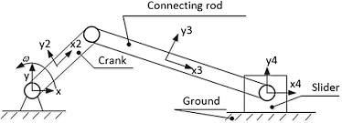

import MechanicsOfMaterialsComments from '../../../../components/mechanics-of-materials/MechanicsOfMaterialsComments.astro';
import TawkWidget from '../../../../components/TawkWidget.astro';
import UniversalContentContributors from '../../../../components/UniversalContentContributors.astro';
import InArticleAd from '../../../../components/InArticleAd.astro';
import Copyright from '../../../../components/Copyright.astro';
import BionicText from '../../../../components/BionicText.astro';
import TailwindWrapper from '../../../../components/TailwindWrapper.jsx';
import { Tabs, TabItem } from '@astrojs/starlight/components';
import { Card, CardGrid, Badge, Steps, LinkButton, FileTree } from '@astrojs/starlight/components';

<UniversalContentContributors 
  contributors={frontmatter.contributors}
/>


A connecting rod breaks in an engine, or a pin shears in a linkage, and the machine stops until the part is replaced. Most failures of this kind can be predicted on paper with one division: the force on the part, divided by the area of metal that carries it. That number is the stress. This lesson gives you stress, strain, Young's modulus and Poisson's ratio in plain terms, and uses them on three real parts: a connecting rod in compression, a tie rod in tension and a clevis pin in double shear. #StressAnalysis #MechanicsOfMaterials #ConnectingRod

## Learning Objectives

By the end of this lesson, you will be able to:

1. **Analyze** real mechatronic systems to identify the components that carry critical loads
2. **Calculate** normal stress, shear stress, strain, and the material properties that link them (Young's modulus, Poisson's ratio)
3. **Apply** Hooke's law to predict elastic deformation under tension, compression, and shear
4. **Evaluate** a design against yield strength with a safety factor, and read the lateral contraction that Poisson's ratio predicts

:::tip[Try it as you read]
This lesson pairs with the [Axial Loading Simulator](/product-development/axial-loading-simulator/): load a single bar in tension and watch the stress, strain, and elongation update as you change the force, diameter, and material. The [Axial Loading Experiments](/education/mechanics-of-materials/axial-loading-experiments/) reproduce the worked examples below step by step with Python.
:::

## Real-World System Problem: The crank-slider mechanism

<InArticleAd />


A crank-slider mechanism changes rotation into straight-line motion. It is inside every piston engine and piston compressor. The crank turns, the piston (the slider) moves in a straight line, and the connecting rod joins the two. On each compression stroke the rod is squeezed along its length by a large force, and on the return stroke it is pulled. This happens thousands of times a minute.

<div style={{ display: 'flex', justifyContent: 'center', width: '100%' }}>
  <TailwindWrapper>
	
  </TailwindWrapper>
</div>

### The stress problem

> **Engineering Question:** During the compression stroke a large force acts on the connecting rod. How do we know that the rod will not break or bend permanently, and how much shorter does it become under the load?

"It looks strong enough" is not an answer. One broken rod or one sheared pin stops the whole machine, whatever the quality of its electronics. To answer the question with numbers we need two ideas, stress and strain, and a few properties of the material.

## Fundamental Theory: Stress, strain, and material properties

<InArticleAd />


Four quantities answer the question: stress, strain, Young's modulus and Poisson's ratio. A fifth number, the safety factor, compares the stress in a part with the stress its material can stand.

### What is stress?

Press on a wooden table with your palm. Then press with the same force through a drawing pin. The pin goes in, because the same force now acts on a very small area. What damages the wood is the force on each square millimetre.

Stress is this idea inside a part. Cut the part in your mind, at right angles to the load. The cut face must carry the whole force. Stress is that force divided by the area of the face.

<Card title="Normal stress" icon="document">
$$\sigma = \frac{F}{A}$$

Where:
- $\sigma$ (sigma) = normal stress, in pascals (1 Pa = 1 N/m²)
- $F$ = force on the cut face, in newtons (N)
- $A$ = area of the cut face, the cross-sectional area (m²)

The same force on a smaller area gives a higher stress.
</Card>


In panel (a) the stress on the exposed face balances the force $F$ on the other end of the left part. Unlike the drawing pin, which presses on a surface, stress acts on every cut you can imagine inside the part. Panel (b) is for Poisson's ratio, later in this section.

A pascal is very small, so machine parts are worked in megapascals: $1\ \text{MPa} = 1{,}000{,}000\ \text{Pa} = 1\ \text{N/mm}^2$. Put the force in newtons and the area in square millimetres, and the answer is in MPa. Stiffness values use gigapascals: $1\ \text{GPa} = 1{,}000\ \text{MPa}$.

<Tabs>
  <TabItem label="Normal stress">
    
    **Normal stress ($\sigma$)** acts at right angles to the cut face.
    - Tensile: the material is pulled (taken as positive)
    - Compressive: the material is squeezed (taken as negative)
    
</TabItem>
  <TabItem label="Shear stress">
    
    **Shear stress ($\tau$, tau)** acts along the cut face and tries to slide one side past the other, as scissors do to paper. A pin loaded across its length carries shear. It is also a force divided by an area: $\tau = F/A_{shear}$, in MPa.
    
</TabItem>
</Tabs>

### What is strain?

Stretch a rubber band 100 mm long until it is 150 mm long. It grew by half of its first length. A band 200 mm long that grows by the same 50 mm is stretched only half as hard. Strain is the change in length divided by the original length, so it describes how hard the material is stretched, whatever the size of the part.

<Card title="Normal strain" icon="document">
$$\epsilon = \frac{\delta_L}{L_0}$$

Where:
- $\epsilon$ (epsilon) = normal strain (a ratio, so it has no unit)
- $\delta_L$ (delta) = change in length (mm)
- $L_0$ = original length (mm)

The rubber band reaches a strain of 0.5. A steel part in service reaches about 0.001, one part in a thousand, and you cannot see it. Small strains are often written in microstrain: 0.001 is 1,000 microstrain.
</Card>

### Hooke's law: stress and strain rise together

A metal bar behaves like a very stiff spring. Pull twice as hard and it stretches twice as far, and when you let go it returns to its first length. In stress and strain, this is Hooke's law: stress equals a constant of the material multiplied by strain.

<Card title="Hooke's law" icon="document">
$$\sigma = E \cdot \epsilon$$

$E$ is Young's modulus, the stiffness of the material, in GPa. It is the stress needed for each unit of strain. Steel has $E \approx 200$ GPa and aluminum $E \approx 70$ GPa, so a steel part stretches about a third as much as an aluminum part of the same shape under the same load.

Put $\sigma = F/A$ and $\epsilon = \delta_L/L_0$ into Hooke's law, and you have the change in length of a bar directly:

$$\delta_L = \frac{F \, L_0}{A \, E}$$
</Card>

Hooke's law holds only up to a limit. Above it the metal does not return, and that limit is the subject of the yield strength below.

### Poisson's ratio: lateral strain

The rubber band also becomes thinner as you stretch it. Every material does this. Poisson's ratio says how much: it is the strain across the bar divided by the strain along it.

<Card title="Poisson's ratio" icon="document">
$$\nu = -\frac{\epsilon_{lateral}}{\epsilon_{longitudinal}}$$

Where:
- $\nu$ (nu) = Poisson's ratio (no unit)
- $\epsilon_{lateral}$ = strain across the load direction
- $\epsilon_{longitudinal}$ = strain along the load direction

A bar that becomes longer becomes thinner, so the two strains have opposite signs. The minus sign makes $\nu$ a positive number. It is about 0.3 for steel and aluminum, about 0.2 for concrete and close to 0.5 for rubber.
</Card>

### Yield strength and the safety factor

Bend a paper clip a little and it springs back. Bend it far and it stays bent. The stress at which a metal stops springing back is its yield strength, $\sigma_{yield}$, in MPa. A machine part must stay below it.

The safety factor (SF), also called the factor of safety, is the yield strength divided by the stress in the part:

$$\text{SF} = \frac{\sigma_{yield}}{\sigma}$$

It has no unit. A safety factor of 1 means the part is at its limit, and 3 means the stress could be three times as high before the part yields. The reserve covers what the calculation cannot know: a shock load, a weaker batch of steel, wear.

## Application 1: Crank-slider connecting rod in compression

<InArticleAd />


Now apply the theory to the connecting rod of the crank-slider.

<div style={{ display: 'flex', justifyContent: 'center', width: '100%', margin: '0.25rem 0 1rem' }}>
  <LinkButton href="/product-development/crank-slider-mechanism-simulator/" target="_blank" variant="primary" icon="rocket" iconPlacement="start">Open the Crank-Slider Simulator</LinkButton>
</div>

:::note[System Problem Statement]
- **Component:** steel connecting rod, between the crank and the piston
- **Peak compression force:** $F = 15{,}000$ N
- **Cross-sectional area:** $A = 500$ mm²
- **Length:** $L = 150$ mm
- **Material:** steel, $E = 200$ GPa, $\sigma_{yield} = 350$ MPa
- **Task:** find the peak compressive stress, the safety factor against yield, and the change in length under load

**Key Question:** Is this rod safe under peak compression, and how much does it shorten?
:::

```text
  15,000 N                               15,000 N
 ─────────► ┌─────────────────────────┐ ◄─────────
            │ steel rod, A = 500 mm²  │
            └─────────────────────────┘
            │◄────── L = 150 mm ─────►│
```

### Step 1: Peak compressive stress

<details>
<summary>**Click to reveal the stress calculation**</summary>

<Steps>

1. **Divide the force by the area.** Work in newtons and square millimetres, so that the answer is in MPa:

   $$\sigma = \frac{F}{A} = \frac{15{,}000 \text{ N}}{500 \text{ mm}^2} = 30 \text{ N/mm}^2 = 30 \text{ MPa}$$ ✅

2. **Read the result.** The rod carries a peak compressive stress of **30 MPa**, far below the 350 MPa yield strength of the steel. ✅

</Steps>

</details>

### Step 2: Safety factor

<details>
<summary>**Click to reveal the safety-factor check**</summary>

<Steps>

1. **Divide the yield strength by the stress:**

   $$\text{SF} = \frac{\sigma_{yield}}{\sigma} = \frac{350 \text{ MPa}}{30 \text{ MPa}} = 11.7$$ ✅

2. **Interpret it.** A safety factor of 11.7 is large for a load that is applied once and held. But a connecting rod is not sized by one steady load. Two other limits size it: fatigue, which is cracking after millions of load reversals at a stress far below yield, and buckling, which is a thin rod bowing sideways in compression. The large reserve against yield is what those two limits leave. ✅

</Steps>

:::tip[Safety factor guidelines]
- SF 2 to 3: loads and materials are well known
- SF 4 to 6: some uncertainty in loads or materials
- SF 8 to 12: high uncertainty, or a part that fatigue or buckling also governs
- SF above 15: usually too much metal, which costs weight and money
:::

</details>

### Step 3: Change in length under load

<details>
<summary>**Click to reveal the deflection calculation**</summary>

<Steps>

1. **Find the strain** from Hooke's law, strain = stress / $E$, with both in pascals (30 MPa $= 30 \times 10^6$ Pa, 200 GPa $= 200 \times 10^9$ Pa):

   $$\epsilon = \frac{\sigma}{E} = \frac{30 \times 10^6}{200 \times 10^9} = 1.5 \times 10^{-4}$$ ✅

2. **Find the shortening.** Strain is change in length over length, so the change in length is strain times length:

   $$\delta_L = \epsilon \, L = (1.5 \times 10^{-4})(150 \text{ mm}) = 0.0225 \text{ mm}$$ ✅

   The rod shortens by about 23 micrometres at peak load. An engine does not notice this. A precision positioning system does, as the next application shows. ✅

</Steps>

</details>

## Application 2: Precision tie rod in tension

<InArticleAd />


A camera gantry or the frame of a CNC (computer-controlled) machine often uses a thin steel tie rod to hold two points at a fixed distance. The rod is in tension. Its stretch moves the points apart, so here the change in length matters as much as the stress.

:::note[System Problem Statement]
- **Component:** steel tie rod, $d = 10$ mm diameter, $L = 600$ mm long
- **Tensile load:** $F = 8$ kN
- **Material:** steel, $E = 200$ GPa, $\sigma_{yield} = 350$ MPa, $\nu = 0.3$
- **Task:** find the tensile stress and safety factor, the elongation, and the lateral contraction of the rod diameter

**Key Question:** How far does the rod stretch, and by how much does its diameter shrink while loaded?
:::

```text
   8 kN                                        8 kN
 ◄──────── ┌──────────────────────────────┐ ────────►
           │ steel rod, d = 10 mm         │
           └──────────────────────────────┘
           │◄───────── L = 600 mm ───────►│
```

Set a single steel bar to these values in the simulator, and compare its stress and elongation with the hand calculation below:

<div style={{ display: 'flex', justifyContent: 'center', width: '100%', margin: '0.5rem 0 1rem' }}>
  <LinkButton href="/product-development/axial-loading-simulator/" target="_blank" variant="primary">Open the Axial Loading Simulator</LinkButton>
</div>

### Step 1: Tensile stress and safety factor

<details>
<summary>**Click to reveal the stress and safety factor**</summary>

<Steps>

1. **Cross-sectional area** of the round rod, the area of a circle of diameter $d$:

   $$A = \frac{\pi d^2}{4} = \frac{\pi (10 \text{ mm})^2}{4} = 78.5 \text{ mm}^2$$ ✅

2. **Tensile stress**, force over area, with 8 kN written as 8,000 N:

   $$\sigma = \frac{F}{A} = \frac{8{,}000 \text{ N}}{78.5 \text{ mm}^2} = 101.9 \text{ MPa}$$ ✅

3. **Safety factor against yield**, yield strength over stress:

   $$\text{SF} = \frac{350 \text{ MPa}}{101.9 \text{ MPa}} = 3.4$$ ✅

   A safety factor of 3.4 suits a tie with a steady, well-known load. ✅

</Steps>

</details>

### Step 2: Elongation

<details>
<summary>**Click to reveal the elongation calculation**</summary>

<Steps>

1. **Longitudinal strain**, stress over $E$, both in pascals:

   $$\epsilon = \frac{\sigma}{E} = \frac{101.9 \times 10^6}{200 \times 10^9} = 5.09 \times 10^{-4}$$ ✅

2. **Elongation**, strain times length:

   $$\delta_L = \epsilon \, L = (5.09 \times 10^{-4})(600 \text{ mm}) = 0.306 \text{ mm}$$ ✅

   The rod stretches about 0.31 mm. On a gantry that positions a tool or a camera, three tenths of a millimetre can put a part outside its tolerance, so the design must allow for this stretch. ✅

</Steps>

</details>

### Step 3: Lateral contraction from Poisson's ratio

<details>
<summary>**Click to reveal the Poisson contraction**</summary>

<Steps>

1. **Lateral strain**, Poisson's ratio times the longitudinal strain, with a minus sign because the rod becomes thinner:

   $$\epsilon_{lateral} = -\nu \, \epsilon = -(0.3)(5.09 \times 10^{-4}) = -1.53 \times 10^{-4}$$ ✅

2. **Change in diameter**, lateral strain times diameter:

   $$\Delta d = \epsilon_{lateral} \, d = (-1.53 \times 10^{-4})(10 \text{ mm}) = -1.53 \times 10^{-3} \text{ mm} = -1.5 \text{ }\mu\text{m}$$ ✅

   The diameter becomes about 1.5 micrometres smaller while the rod is loaded. That is very little, but in a press fit or a threaded joint it can be enough to loosen the connection under load. ✅

</Steps>

</details>

:::note[Engineering Insight]
One load gives three results to check: a stress against the strength, an elongation against the tolerance, and a lateral contraction. A part can pass the strength check and still fail its task because it stretches too far.
:::

## Application 3: Clevis pin in double shear

<InArticleAd />


Where one link of a machine joins another, the load usually passes through a pin. The load acts across the pin and tries to cut it, so the pin carries shear stress. The number of places where the pin would be cut decides the stress.


In panel (a) the whole load crosses one section of the pin: single shear. In panel (b) a clevis, a forked fitting, holds the pin on both sides, and two sections share the load: double shear, with a shear area of $2A$. A wrong count of shear planes is the most common mistake here.

:::note[System Problem Statement]
- **Component:** steel clevis pin, $d = 8$ mm diameter, loaded in double shear
- **Load through the joint:** $F = 6$ kN
- **Material:** steel, $\sigma_{yield} = 350$ MPa
- **Task:** find the shear stress in the pin and the safety factor against shear yield

**Key Question:** Will the pin shear off, and how much margin does it have?
:::

### Step 1: Shear stress in double shear

<details>
<summary>**Click to reveal the shear-stress calculation**</summary>

<Steps>

1. **Count the shear planes.** In double shear two cross-sections of the pin carry the load, so the area that resists shear is twice the area of one section:

   $$A_{single} = \frac{\pi d^2}{4} = \frac{\pi (8 \text{ mm})^2}{4} = 50.3 \text{ mm}^2, \qquad A_{shear} = 2 A_{single} = 100.5 \text{ mm}^2$$ ✅

2. **Shear stress**, force over shear area:

   $$\tau = \frac{F}{A_{shear}} = \frac{6{,}000 \text{ N}}{100.5 \text{ mm}^2} = 59.7 \text{ MPa}$$ ✅

   In single shear the same pin would carry twice this stress, about 119 MPa. This is why clevis joints are used for the higher loads. ✅

</Steps>

</details>

### Step 2: Safety factor against shear yield

<details>
<summary>**Click to reveal the shear safety factor**</summary>

<Steps>

1. **Estimate the shear yield strength.** Material tables give the yield strength in tension. A metal that can stretch before it breaks, such as this steel, yields in shear at about $0.577$ of that value (the von Mises relation):

   $$\tau_{yield} \approx 0.577 \, \sigma_{yield} = 0.577 (350 \text{ MPa}) = 202 \text{ MPa}$$ ✅

2. **Safety factor**, shear yield strength over shear stress:

   $$\text{SF} = \frac{\tau_{yield}}{\tau} = \frac{202 \text{ MPa}}{59.7 \text{ MPa}} = 3.4$$ ✅

   The pin has enough reserve. A more cautious rule, the maximum-shear-stress theory, uses $\tau_{yield} = 0.5\,\sigma_{yield} = 175$ MPa and gives $\text{SF} = 2.9$, which is still safe. [Principal Stresses and Failure Analysis](/education/mechanics-of-materials/principal-stresses-failure-analysis/) explains how to choose between the two rules. ✅

</Steps>

</details>

:::note[Engineering Insight]
Normal stress and shear stress are checked separately. A pin that is safe when pulled along its length can still be cut across, and the joint (single or double shear) changes the shear stress by a factor of two.
:::

## Design guidelines for stress and strain

<InArticleAd />


1. Make two checks. The stress must stay below the yield strength with a safety factor, and the change in length must stay within the tolerance. Either check can decide the size.
2. A large safety factor against yield does not cover fatigue or buckling. Parts with a changing load or a slender shape need those checks too.

:::tip[Instrument it]
You cannot measure stress directly, but you can measure strain. Bond a foil strain gauge (a thin resistor whose resistance changes when it is stretched) to the part along the load direction. Multiply the strain it reads by Young's modulus, and you have the real stress. A quarter-bridge circuit into an HX711 or an instrumentation amplifier, read by an [ESP32 or STM32](/education/sensor-actuator-interfacing-stm32/), gives a value that you can [trend on siliconwit.io](https://siliconwit.io) and compare with the yield limit.
:::

## Summary and Next Steps

<InArticleAd />


### Key concepts

1. **Stress** is force over area, $\sigma = F/A$ for normal stress and $\tau = F/A_{shear}$ for shear, with $1\ \text{MPa} = 1\ \text{N/mm}^2$.
2. **Strain** is the ratio $\epsilon = \delta_L / L_0$. Hooke's law $\sigma = E\epsilon$ links it to stress and gives the change in length $\delta_L = FL_0/(AE)$.
3. **Poisson's ratio** links the lateral contraction to the stretch: $\epsilon_{lateral} = -\nu\,\epsilon_{longitudinal}$.
4. **The safety factor** is the yield strength divided by the stress. A safe design also keeps the change in length within tolerance.

Next, [Strain and Mechanical Properties](/education/mechanics-of-materials/strain-and-mechanical-properties/) follows a metal past its yield strength on the full stress-strain curve, and separates two properties that are often confused: stiffness and strength.


<InArticleAd />
<MechanicsOfMaterialsComments />
<TawkWidget />
<Copyright />
